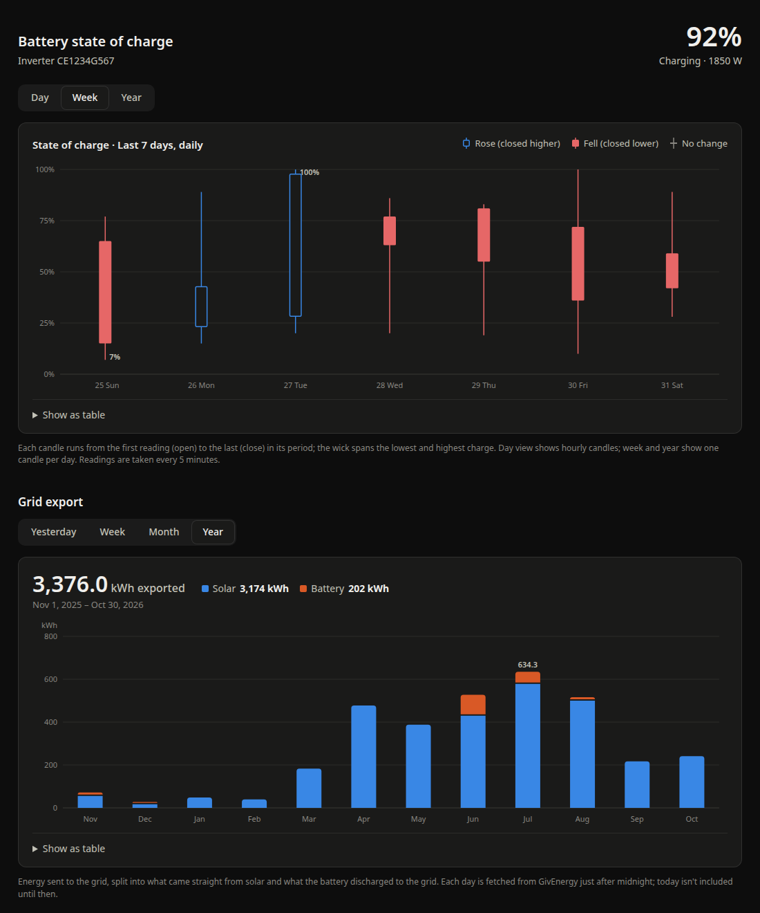
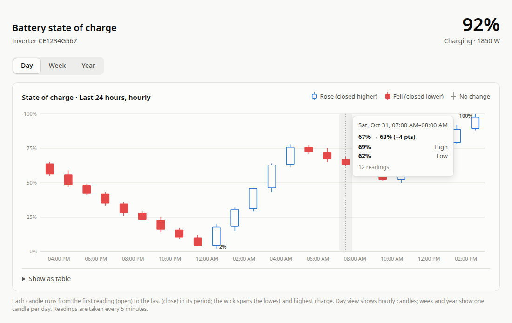
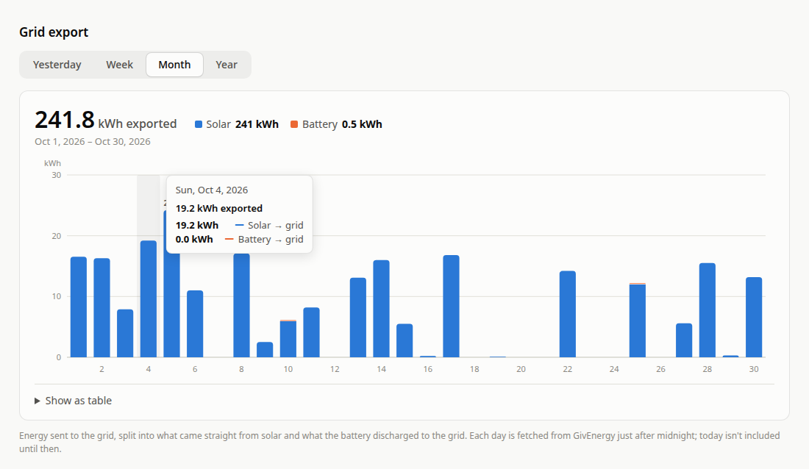
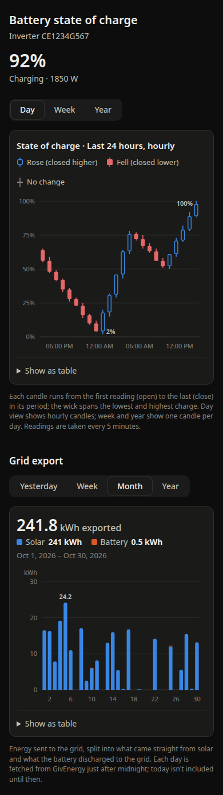
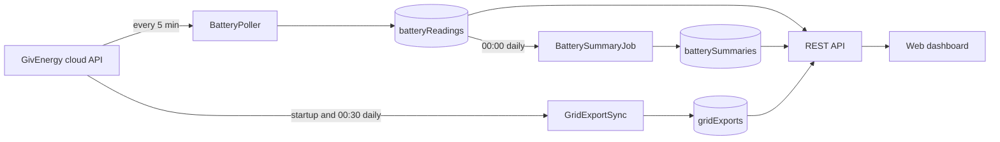

# GivEnergy Battery Reader

A Spring Boot 4 app that reads a GivEnergy inverter and battery from the GivEnergy cloud API. It records the battery's state of charge in MongoDB, keeps a daily history of grid export, and shows both on a web page with candlestick and bar charts.



## Features

- **Live battery status:** state of charge, charging or discharging, current power, and today's charged and discharged kWh, served as JSON.
- **Battery history:** a reading every 5 minutes, stored in MongoDB and summarised each midnight into the day's open, close, minimum and maximum charge.
- **Grid export history:** daily solar → grid and battery → grid kWh, back-filled automatically from the day the inverter was installed and kept up to date each night.
- **Web dashboard:**
  - battery candlestick chart with **Day / Week / Year** views
  - grid export chart with **Yesterday / Week / Month / Year** views
  - hover and keyboard tooltips, a table view of each chart, light and dark mode, and a phone layout
- **No duplicate data:** every stored record has an ID made of the inverter serial and the date or time, so re-fetching overwrites rather than adds.

## Screenshots

| Battery state of charge (Day view) | Grid export (Month view) |
|---|---|
|  |  |



The page also works on a phone (right).

These screenshots come from a real installation, with the inverter serial replaced by a placeholder. The battery charts use sample data, because that installation had only just started recording readings; the grid export charts show its real history.

<br clear="right">

## How it works



The app talks to the **GivEnergy cloud API** (`https://api.givenergy.cloud/v1`) with a personal API token. It doesn't connect to the inverter over your home network. The cloud updates about every 5 minutes, so that's how often the app polls.

| Data | GivEnergy endpoint |
|---|---|
| Live state of charge and battery power | `GET /inverter/{serial}/system-data/latest` |
| Today's charged/discharged kWh | `GET /inverter/{serial}/meter-data/latest` |
| Daily grid export (solar → grid, battery → grid) | `POST /inverter/{serial}/energy-flows` |
| Inverter serial and installation date | `GET /communication-device` |

## Requirements

- **Java 21 or newer:** a full JDK, not just a runtime.
- **MongoDB:** the app has been run against MongoDB 8 with no authentication.
- **A GivEnergy account and API token:** the token needs at least the `api:inverter:read` permission.
- **Internet access:** to reach `api.givenergy.cloud`.

Gradle comes with the project through the wrapper (`./gradlew`), so you don't need to install it.

## Getting started

### 1. Create an API token

At [givenergy.cloud](https://www.givenergy.cloud), go to **Account Settings → Manage API Tokens** and create a token with the `api:inverter:read` permission.

### 2. Configure the app

Create `config/application.properties` in the project root. The `config/` folder is git-ignored, and Spring Boot loads it automatically when the app runs from the project folder:

```properties
givenergy.api-token=<your token>
# Optional: only needed if your account has more than one inverter
#givenergy.inverter-serial=CE1234G567
# Optional: if MongoDB isn't on the default host
#spring.mongodb.uri=mongodb://localhost:27017/givenergy
```

Alternatively, set the `GIVENERGY_API_TOKEN` and `MONGODB_URI` environment variables.

### 3. Run it

**From IntelliJ:** open the project folder (it's detected as a Gradle project), set the Project SDK to a Java 21+ JDK, and run `GivEnergyApplication` or the Gradle `bootRun` task.

**From a terminal:**

```bash
./gradlew bootRun
```

### 4. Open the dashboard

Go to <http://localhost:8081/>.

The first time the app starts, it back-fills the grid export history. That takes about 10 seconds for 4 years of data. Battery charts fill up as readings arrive, and daily battery candles appear after the first midnight summary.

## Configuration

These are set in `application.properties`, `config/application.properties` or on the command line (`--name=value`):

| Property | Environment variable | Default | Description |
|---|---|---|---|
| `givenergy.api-token` | `GIVENERGY_API_TOKEN` | *(required)* | GivEnergy API token |
| `givenergy.inverter-serial` | `GIVENERGY_INVERTER_SERIAL` | first inverter on the account | Which inverter to read |
| `givenergy.poll-interval` | | `5m` | How often to read and record the battery; `0` turns it off |
| `givenergy.timezone` | | `Europe/London` | Defines "a day" for summaries, and the time zone for the midnight jobs |
| `givenergy.grid-export.sync-on-startup` | | `true` | Back-fill or catch up grid export when the app starts |
| `givenergy.grid-export.cron` | | `0 30 0 * * *` | When to fetch the previous day's grid export |
| `spring.mongodb.uri` | `MONGODB_URI` | `mongodb://storenator.bluelarma.com:27017/givenergy` | MongoDB connection, including the database name |
| `server.port` | | `8081` | Web server port |

## REST API

| Method and path | Description |
|---|---|
| `GET /api/battery` | Live battery status from GivEnergy |
| `GET /api/battery/candles?range=day\|week\|year` | State-of-charge candles: hourly for `day`, daily for `week` and `year` |
| `POST /api/battery/summaries/{yyyy-MM-dd}` | Build or rebuild a day's battery summary |
| `GET /api/grid/exports?range=yesterday\|week\|month\|year` | Grid export totals and bars: daily, or monthly for `year` |
| `POST /api/grid/exports/sync` | Fetch grid export now; returns the number of days written |
| `GET /actuator/health` | Health check, including MongoDB |

Example: `GET /api/battery`

```json
{
  "inverterSerial": "CE1234G567",
  "time": "2026-10-31T12:00:00Z",
  "stateOfChargePercent": 76,
  "state": "CHARGING",
  "chargePowerWatts": 850,
  "dischargePowerWatts": 0,
  "temperatureCelsius": 21.5,
  "chargedTodayKwh": 3.4,
  "dischargedTodayKwh": 1.1
}
```

`state` is `CHARGING`, `DISCHARGING` or `IDLE`. If GivEnergy rejects the token, the endpoints return `502` with an explanation instead of a generic error.

## Data stored in MongoDB

All collections are in the database named in `spring.mongodb.uri`. Dates are stored as UTC midnight, and times as UTC.

| Collection | One document per | `_id` | Written by |
|---|---|---|---|
| `batteryReadings` | cloud reading (about every 5 minutes) | `<serial>_<reading time>` | `BatteryPoller` |
| `batterySummaries` | inverter per day: open/close/min/max charge, peak power, kWh in and out | `<serial>_<date>` | `BatterySummaryJob` at 00:00 |
| `gridExports` | inverter per day: solar → grid, battery → grid and total kWh | `<serial>_<date>` | `GridExportSync` at startup and 00:30 |

## Scheduled jobs

| Job | When | What it does |
|---|---|---|
| `BatteryPoller` | every `givenergy.poll-interval` | Reads the live status, logs it and saves a `batteryReadings` document |
| `BatterySummaryJob` | 00:00 in `givenergy.timezone` | Summarises the previous day's readings into `batterySummaries` |
| `GridExportSync` | 15 s after startup, and at 00:30 | Fetches every day since the last stored one (or since installation, on the first run). It re-checks the last 2 stored days and only writes days that are new or have changed |

## Development

```bash
./gradlew build                                   # compile, run all tests, build the jar in build/libs
./gradlew test --tests GridExportSyncTests        # one test class
./gradlew test --tests 'CandleServiceTests.weekViewIsPastSummariesPlusToday'   # one test
java -jar build/libs/givenergy-0.0.1-SNAPSHOT.jar # run the built jar
```

### Project layout

```
src/main/java/com/example/givenergy/
├── client/     GivEnergy API client and response types
├── battery/    live status, readings, daily summaries, candlestick data
├── grid/       grid export sync and view data
└── *.java      application, configuration properties, Mongo config, error handling
src/main/resources/
├── application.properties
└── static/     the web dashboard (index.html, a single file with no build step) and favicons
```

The dashboard is plain HTML, CSS and JavaScript with hand-drawn SVG charts. It doesn't use any external libraries or CDNs.

## Troubleshooting

| Problem | Fix |
|---|---|
| `APPLICATION FAILED TO START … givenergy.apiToken … is required` | No token configured. Add it to `config/application.properties` or set `GIVENERGY_API_TOKEN`. A variable exported in a terminal doesn't reach apps started from IntelliJ; set it in the run configuration instead. |
| `GivEnergy rejected the API token (HTTP 401)` | The token is wrong, revoked or expired. Test it with `curl -H "Authorization: Bearer <token>" https://api.givenergy.cloud/v1/communication-device`. |
| `HTTP 403` / "lacks permission" | Create a token with the `api:inverter:read` permission. |
| `Port 8081 was already in use` | Stop the other process, or set `server.port`. |
| `release version 21 not supported` / no `javac` | The build is using a Java runtime rather than a JDK. Point `JAVA_HOME` (or IntelliJ's Project SDK) at a full JDK 21+. |
| Battery Week/Year charts only show today | Daily candles come from midnight summaries, so they appear one day at a time. To build a missed day, run `POST /api/battery/summaries/{date}`. |

## License

No license has been chosen yet.
